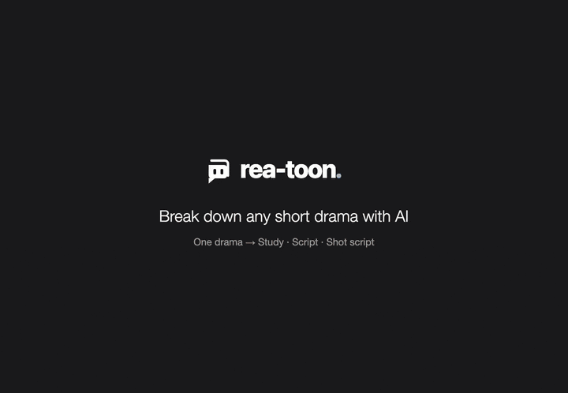

<div align="center">

<picture>
  <source media="(prefers-color-scheme: dark)" srcset="docs/brand/logo-light.svg">
  
</picture>

Break down any short drama with AI: rea-toon is a tool for learning from short dramas.

Why it went viral, how the script is written, how every shot is filmed: three views of one drama.

Every breakdown is also written as **[VIDEO.md](https://videomd.github.io/videomd/)**, an open format that agents read layer by layer.

[中文](i18n/README_zh.md) | English

[](https://github.com/JuneYaooo/rea-toon/stargazers)


[](https://videomd.github.io/videomd/)
[](https://github.com/JuneYaooo/rea-video)
[](LICENSE)

[](https://linux.do/) [](https://discord.gg/dZj8D3GqWT) [](https://x.com/yao_june12106)

⭐ *Help more people find rea-toon. Star this repo!*

<a href="docs/demo_en.mp4"></a>

The pages of a 10-episode drama after the breakdown. Click for the full demo with sound (1 min).<br>
<sub>Translated into English for this demo; rea-toon writes the pages in Chinese.</sub>

</div>

## Quick start

rea-toon is built for AI agents. In Claude Code, Codex or any agent that can run commands, say:

```text
Install https://github.com/JuneYaooo/rea-toon, then break down this short drama: <a video file, or a folder with one video per episode>
```

The agent installs the CLI, learns the workflow ([skills/rea-toon/SKILL.md](skills/rea-toon/SKILL.md)) and runs it to the end. You need ffmpeg and Python 3.10+.

**Vision is required.** The breakdown looks at every shot, so you need at least one of these: an agent that can see images (Claude Code and Codex both can), or a vision model with an OpenAI-compatible API configured for rea-toon (Gemini, Doubao, Qwen-VL…). By default the agent answers itself and no key is needed; for a long series (dozens or hundreds of episodes), configure the API model: billed per call, and it runs in parallel.

**Breaking down a drama uses a lot of tokens**: every episode means looking at dozens of frame grids, about 30 vision calls. For a series, try 5 episodes first to see the results and the cost, then go on with the rest (the agent can break down just the first 5).

Each breakdown gives you two outputs:

- **Pages, for you**: open one `index.html`. It holds the study, the script and the shot script.
- **[VIDEO.md](https://videomd.github.io/videomd/), for your AI**: `VIDEO.md` + `video/`, the same open format as [rea-video](https://github.com/JuneYaooo/rea-video). Ask your agent anything about the drama later, or hand it to other tools: they read this instead of watching the video again.

> The pages and reports are in Chinese for now: rea-toon is made for Chinese short dramas.

## What you get

One bar on top: which episode (series only) and one of three views.

| View | Answers | What's in it |
|---|---|---|
| **Study** | Why it works and what you can take from it | The hook in one line, why viewers stay, weak spots, a reusable formula, remix ideas, the pacing curve and structure; the evidence (emotion ledger, information gaps, characters and pairings, production load) is folded at the bottom |
| **Script** | What the script looks like | Standard short-drama script format: scenes, characters, actions, punctuated lines, OS / inner voice / narration; exports to PDF |
| **Shot script** | How each shot is filmed | Character sheets (headshot, looks, a voice sample cut from the original vocal track); per shot: thumbnail, framing, what happens, lines, sound, motion, duration; exports to PDF |

- Click any "shot N" or thumbnail and that part of the original plays in the corner, so you can check every claim against the picture.
- A series also gets the cross-episode view: phases, recurring tropes, character arcs, setups and payoffs, episode-end hooks, paywall points.
- Emotion beats are counted by code from the emotion tagged on every shot (satisfaction, frustration, heartbreak, sweetness, laughs, suspense, shock, hype), not summarized by a model afterwards.

## What it can break down

It detects the format and looks at different things for each:

| Format | What it looks at |
|---|---|
| Live-action drama | Who dominates each scene and which line turns it; the rhythm of face-slaps and twists; how many sets and outfits carry an episode |
| AI live-action drama | What makes a character land at first sight; how much is spectacle only AI can film; how cutting and music hold scenes with little lip-sync |
| 2D / 3D animated drama | Where panels, manga marks and effects amplify emotion; what makes characters memorable; thrills made by camera movement |
| Motion comic, meme comic | How long one picture holds and how fast they change; which panels get partial motion; joke density, voice and sound |
| Commentary | Where the hooks, cliffhangers and punchlines sit in the narration; whether picture changes land on new information; speech rate and information density |

One video or a whole series; a series can stop and pick up where it left off. The source is video you already have on disk: one file, or a folder with one video per episode (sorted by the episode number in the file name). Links are not downloaded. For a compilation with many episodes in one file, the agent first confirms where each episode starts with you, then splits it.

## How it works

1. **Split**: [rea-video](https://github.com/JuneYaooo/rea-video) cuts the shots and separates voice from music; local OCR reads the subtitle track, only text on the subtitle line.
2. **Cast**: a character table (disguises and costume changes merged into one person), then who is on screen in each shot and what they do.
3. **Lines**: who says every line across the episode; lines where that disagrees with what the shots show are settled by looking at the frames.
4. **Read the script**: scenes and the look in each, text on screen, camera angles and eyelines, dramatic beats, the point and emotion of every shot, information gaps; in a series every episode is read with what came before.
5. **Results**: code measures pacing, the emotion ledger and screen time; then the report, the script and the shot script are written, and the pages and the VIDEO.md package are built.

Every call comes with evidence (shot number, time, line, frame). Fix what it got wrong and rebuild the pages.

## FAQ

<details>
<summary>What model do I need? What does it cost?</summary>

A model that can see images is required; a text-only model can't do it. The simplest is an agent that can see images (Claude Code, Codex) answering itself, no key needed: the command stops where a judgment is needed, the agent looks, answers and runs it again, a dozen or so rounds per episode. That's fine for a few episodes.

</details>

<details>
<summary>How is it related to rea-video?</summary>

[rea-video](https://github.com/JuneYaooo/rea-video) reverse-engineers how one video was made: filmed, AI-generated or coded. rea-toon is built on it (shot cuts, voice and music separation) and adds the layer only drama has: characters, lines and speakers, dramatic beats, the emotion ledger, the structure of a whole series. "How was this video made?" is rea-video; "why is this drama good and how is it written?" is rea-toon.

</details>

## Community

Come to [LINUX.DO](https://linux.do/) to share how you use it.

Problems or ideas: open an [issue](https://github.com/JuneYaooo/rea-toon/issues).

## Credits

- Built on [rea-video](https://github.com/JuneYaooo/rea-video): shot cuts, voice and music separation.
- The package uses the open [VIDEO.md](https://github.com/videomd/videomd) format; subtitles are read with [RapidOCR](https://github.com/RapidAI/RapidOCR).
- The pictures and sound in the demo come from a breakdown of a public short drama. Copyright belongs to its owners; shown only to demonstrate the tool.

## License

**No commercial use.** Licensed under the [PolyForm Noncommercial License 1.0.0](LICENSE): personal study, research and other noncommercial use may use, modify and share it, with the license terms and copyright notice; any commercial use needs the author's written permission first.
