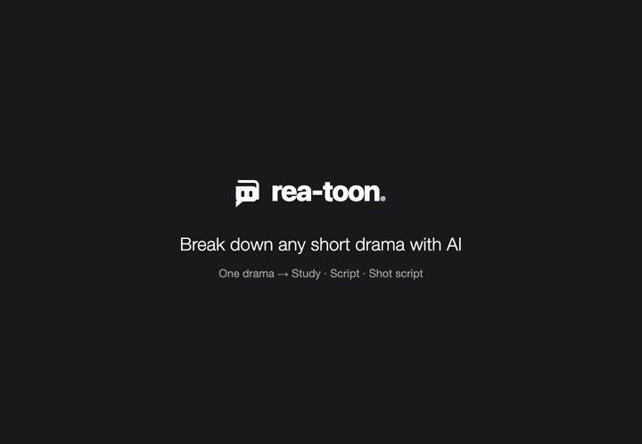

<div align="center">

<picture>
  <source media="(prefers-color-scheme: dark)" srcset="../docs/brand/logo-light.svg">
  
</picture>

あらゆるショートドラマを AI で分解します：アニメーションのコミックドラマ、実写、AI 生成のどれでも。

ショートドラマから学ぶためのツールです：なぜバズったのか、脚本はどう書かれているのか、各ショットはどう撮られているのか。

すべての分解結果は **[VIDEO.md](https://videomd.github.io/videomd/)** としても書き出されます。エージェントが層ごとに読めるオープンなフォーマットです。

[中文](README_zh.md) | [English](../README.md) | 日本語

[](https://github.com/JuneYaooo/rea-toon/stargazers)


[](https://videomd.github.io/videomd/)
[](https://github.com/JuneYaooo/rea-video)
[](../LICENSE)

[](https://linux.do/) [](https://discord.gg/dZj8D3GqWT) [](README_zh.md#社区) [](https://x.com/yao_june12106)

⭐ *rea-toon をより多くの人に届けるために、このリポジトリに Star をお願いします！*

<a href="../docs/demo_en.mp4"></a>

分解後の 10 話のドラマのページです。クリックすると音声付きの完全なデモ（1 分）を再生します。<br>
<sub>rea-toon は、あなたがエージェントと話している言語で分解結果を書きます。</sub>

</div>

## クイックスタート

rea-toon は AI エージェント向けに作られています。Claude Code、Codex、またはコマンドを実行できる任意のエージェントで、次のように伝えてください：

```text
Install https://github.com/JuneYaooo/rea-toon, then break down this short drama: <a video file, or a folder with one video per episode>
```

エージェントが CLI をインストールし、ワークフロー（[skills/rea-toon/SKILL.md](../skills/rea-toon/SKILL.md)）を学んで、最後まで実行します。ffmpeg と Python 3.10 以降が必要です。

**画像を見る能力（ビジョン）が必須です。** 分解ではすべてのショットを見るため、次のいずれか少なくとも 1 つが必要です：画像を見られるエージェント（Claude Code と Codex はどちらも対応しています）、または rea-toon 用に設定した OpenAI 互換 API のビジョンモデル（Gemini、Doubao、Qwen-VL など）。デフォルトではエージェント自身が回答するため、キーは不要です。長いシリーズ（数十話から数百話）の場合は API モデルを設定してください：呼び出しごとの課金で、並列に実行されます。

**ドラマの分解には大量のトークンを使います**：1 話ごとに数十枚のフレームグリッドを見る必要があり、ビジョンの呼び出しはおよそ 30 回になります。シリーズの場合は、まず 5 話で試して結果とコストを確認してから、残りに進んでください（エージェントに最初の 5 話だけを分解させることもできます）。

1 回の分解で、2 つの出力が得られます：

- **あなたのためのページ**：`index.html` を 1 つ開きます。研究、脚本、撮影台本が入っています。
- **あなたの AI のための [VIDEO.md](https://videomd.github.io/videomd/)**：`VIDEO.md` + `video/`。[rea-video](https://github.com/JuneYaooo/rea-video) と同じオープンなフォーマットです。後からドラマについてエージェントに何でも質問したり、他のツールに渡したりできます：動画を見直す代わりに、これを読んでくれます。

> **あなたの言語で。** 分解結果は、あなたがエージェントと話している言語で書かれます：要約、ショットごとのメモ、レポート、脚本のト書き、そしてページ自体の見出しまで。セリフと字幕はドラマの元の言語のままです。ページの枠組みは英語と中国語が組み込まれています。それ以外の言語では、英語の枠組みの中に内容があなたの言語で書かれます。

## 得られるもの

上部に 1 本のバーがあります：どの話か（シリーズのみ）と、3 つのビューのいずれか。

| ビュー | 答えること | 内容 |
|---|---|---|
| **研究** | なぜうまくいっているのか、そこから何を学べるか | 1 行で表したフック、視聴者が見続ける理由、弱点、再利用できる公式、リミックスのアイデア、ペース曲線と構成。根拠（感情の台帳、情報ギャップ、キャラクターと組み合わせ、制作の負荷）は下部に折りたたまれています |
| **脚本** | 脚本がどう見えるか | 標準的なショートドラマの脚本形式：シーン、キャラクター、ト書き、句読点付きのセリフ、OS / 心の声 / ナレーション。PDF に書き出せます |
| **撮影台本** | 各ショットがどう撮られているか | キャラクターシート（顔写真、外見、元のボーカルトラックから切り出した声のサンプル）。ショットごとに：サムネイル、構図、何が起きるか、セリフ、音、動き、尺。PDF に書き出せます |

- 「ショット N」やサムネイルをクリックすると、元の映像のその部分が隅で再生されるので、すべての主張を映像と照らし合わせて確認できます。
- シリーズには、話をまたいだビューも用意されます：フェーズ、繰り返し使われるお約束、キャラクターアーク、伏線と回収、各話末のフック、課金ポイント。
- 感情のビートは、モデルが後から要約するのではなく、各ショットにタグ付けされた感情（スカッと感、もどかしさ、切なさ、甘さ、笑い、サスペンス、衝撃、盛り上がり）からコードで数えられます。

## 分解できるもの

フォーマットを検出し、それぞれで異なる点を見ます：

| フォーマット | 見るポイント |
|---|---|
| 実写ドラマ | 各シーンを誰が支配し、どのセリフが流れを変えるか。ざまぁ展開やどんでん返しのリズム。1 話をいくつのセットと衣装でまかなっているか |
| AI 実写ドラマ | キャラクターが一目で印象に残る理由。AI にしか撮れない見せ場がどれだけあるか。リップシンクが少ない中で、カット割りと音楽がどうシーンを支えているか |
| 2D / 3D アニメーションドラマ | コマ割り、漫画的な記号、エフェクトがどこで感情を増幅しているか。キャラクターが記憶に残る理由。カメラワークが生み出すスリル |
| モーションコミック、ミームコミック | 1 枚の絵をどれだけ長く見せ、どれだけ速く切り替えるか。どのコマに部分的な動きを付けるか。ギャグの密度、声、音 |
| 解説動画 | ナレーションのどこにフック、クリフハンガー、オチがあるか。画面の切り替えが新しい情報と合っているか。話す速さと情報の密度 |

1 本の動画でもシリーズ全体でも対応します。シリーズは途中で止めて、続きから再開できます。対象はすでにディスク上にある動画です：1 つのファイル、または 1 話につき 1 本の動画が入ったフォルダー（ファイル名の話数順に並べ替えられます）。リンクからのダウンロードは行いません。1 つのファイルに多くの話が入った総集編の場合は、エージェントがまず各話の開始位置をあなたと確認してから分割します。

## 仕組み

1. **分割**：[rea-video](https://github.com/JuneYaooo/rea-video) がショットを切り出し、声と音楽を分離します。ローカルの OCR が字幕トラックを読み取ります（字幕行のテキストのみ）。
2. **キャスト**：キャラクター表を作成し（変装や衣装替えは 1 人にまとめます）、各ショットに誰が映っていて何をしているかを特定します。
3. **セリフ**：話全体のすべてのセリフについて誰が話しているかを特定します。ショットの内容と食い違うセリフは、フレームを見て判断します。
4. **脚本の読み解き**：シーンとそれぞれの見た目、画面上のテキスト、カメラアングルと視線、ドラマのビート、各ショットの意図と感情、情報ギャップ。シリーズでは、各話をそれまでの内容を踏まえて読みます。
5. **結果**：ペース、感情の台帳、出演時間をコードで計測します。その後、レポート、脚本、撮影台本が書かれ、ページと VIDEO.md パッケージが生成されます。

すべての判断には根拠（ショット番号、時間、セリフ、フレーム）が付きます。間違っていた箇所を修正して、ページを再生成してください。

## よくある質問

<details>
<summary>どんなモデルが必要ですか？ 費用はどれくらいですか？</summary>

画像を見られるモデルが必須で、テキスト専用のモデルでは対応できません。最も簡単なのは、画像を見られるエージェント（Claude Code、Codex）自身に回答させる方法で、キーは不要です：判断が必要なところでコマンドが止まり、エージェントが見て回答し、再度実行します。1 話あたり十数回のやり取りになります。数話であればこれで十分です。

</details>

<details>
<summary>rea-video とはどういう関係ですか？</summary>

[rea-video](https://github.com/JuneYaooo/rea-video) は、1 本の動画がどう作られたか（撮影されたものか、AI 生成か、コードで作られたか）をリバースエンジニアリングします。rea-toon はその上に構築されており（ショットの切り出し、声と音楽の分離）、ドラマにしかない層を追加します：キャラクター、セリフと話者、ドラマのビート、感情の台帳、シリーズ全体の構成。「この動画はどう作られたのか？」が rea-video、「このドラマはなぜ面白く、どう書かれているのか？」が rea-toon です。

</details>

## コミュニティ

[LINUX.DO](https://linux.do/) で、あなたの使い方を共有してください。

問題やアイデアは、[issue](https://github.com/JuneYaooo/rea-toon/issues) を作成してください。

## クレジット

- [rea-video](https://github.com/JuneYaooo/rea-video) の上に構築されています：ショットの切り出し、声と音楽の分離。
- パッケージにはオープンな [VIDEO.md](https://github.com/videomd/videomd) フォーマットを使用し、字幕は [RapidOCR](https://github.com/RapidAI/RapidOCR) で読み取っています。
- デモの映像と音声は、公開されているショートドラマの分解結果から取ったものです。著作権はその権利者に帰属し、ツールのデモンストレーションのためにのみ掲載しています。

## ライセンス

**商用利用は禁止です。** [PolyForm Noncommercial License 1.0.0](../LICENSE) のもとでライセンスされています：個人的な学習、研究、その他の非商用目的であれば、ライセンス条項と著作権表示を付けたうえで、使用、改変、共有できます。いかなる商用利用にも、事前に作者の書面による許可が必要です。
