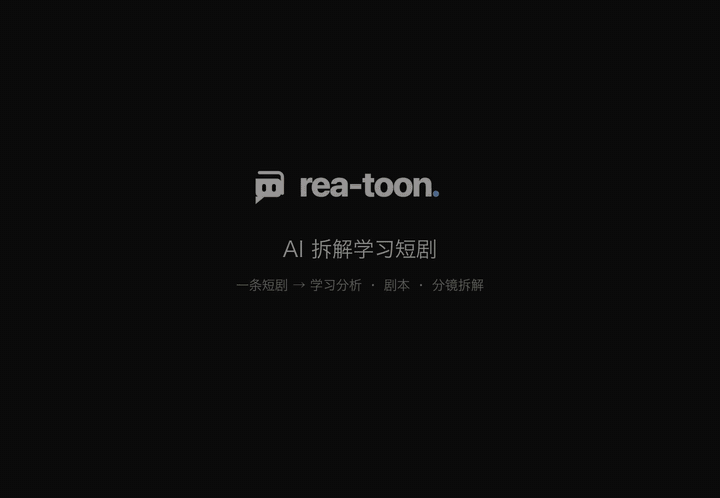

<div align="center">

<picture>
  <source media="(prefers-color-scheme: dark)" srcset="../docs/brand/logo-light.svg">
  
</picture>

AI 拆解学习短剧：rea-toon 是用来学习短剧的工具。

一部短剧为什么火、剧本怎么写、每一镜怎么拍，拆成三份给你看。

拆解结果同时写成 **[VIDEO.md](https://videomd.github.io/videomd/)**：一个开放格式，agent 一层一层按需读。

中文 | [English](../README.md)

[](https://github.com/JuneYaooo/rea-toon/stargazers)


[](https://videomd.github.io/videomd/)
[](https://github.com/JuneYaooo/rea-video)
[](../LICENSE)

[](https://linux.do/) [](https://discord.gg/dZj8D3GqWT) [](https://x.com/yao_june12106)

⭐ *觉得有用就点个 Star 吧，能让更多人看到它！*

<a href="../docs/demo.mp4"></a>

一部 10 集短剧拆完后的页面。点上图看带声音的完整演示（1 分钟）。

</div>

## 快速开始

rea-toon 是给 AI agent 用的。打开 Claude Code、Codex 这类能跑命令的 agent，直接说：

```text
安装 https://github.com/JuneYaooo/rea-toon ，然后拆解这部短剧：<视频文件，或放着各集视频的文件夹>
```

agent 会自己装好命令行工具，读懂拆解流程（[skills/rea-toon/SKILL.md](../skills/rea-toon/SKILL.md)），然后一路跑完。电脑上需要有 ffmpeg 和 Python 3.10 以上。

**必须能看图。** 拆解要看每一镜的画面，所以两者至少要有一个：你用的 agent 本身能看图（Claude Code、Codex 都可以），或者给 rea-toon 配一个能看图的接口模型（兼容 OpenAI 接口的都行，比如 Gemini、豆包、Qwen-VL）。默认由 agent 自己看图作答，不用配密钥；几十上百集的长剧建议配接口模型，按次计费，可以并发跑。

**短剧拆解比较耗 token**：每集要看几十张画面拼图，一集大约 30 次看图调用。整部剧建议先拆 5 集试试，看看效果和花费，再接着拆后面的集（agent 会帮你只拆前 5 集）。

拆完得到两样东西：

- **给人看的页面**：只开一个 `index.html`，里面是学习分析、剧本、分镜拆解。
- **给 AI 读的拆片包**：`VIDEO.md` + `video/`，和 [rea-video](https://github.com/JuneYaooo/rea-video) 用同一个开放格式。之后再问 agent 这部剧的任何问题，或者让下游工具接着用，读的都是它，不用重新看片。

## 拆完是什么样

顶栏一处切换：选哪一集（整部剧才有这一行），看三个方向之一。

| 方向 | 回答什么 | 里面有什么 |
|---|---|---|
| **学习分析** | 这部剧为什么火，能学走什么 | 一句话卖点、留人原因、短板、可复用公式、改编方向、节奏曲线和结构直接在页面上；情绪账、信息差、人物和对手戏、制作量等依据折叠在底部，点开看 |
| **剧本** | 它的剧本长什么样 | 标准短剧剧本格式：场次、人物、△动作、带标点的台词、OS / 内心OS / 旁白；可导出 PDF |
| **分镜拆解** | 每一镜是怎么拍的 | 角色设定（头像、造型图、从原片人声轨切出的配音样本）；逐镜的缩略图、景别、画面描述、台词、音效、动效、时长；可导出 PDF |

- 页面上任何"镜 N"和缩略图都能点，右下角会播放原片的那一段，结论可以当场对着画面核对。
- 整部剧还有跨集的内容：分阶段打法、反复使用的套路、人物弧光、伏笔和回收、集尾钩子、付费卡点。
- 情绪节点是从每一镜标注的情绪（爽 / 憋 / 虐 / 甜 / 笑 / 悬 / 惊 / 燃）里用代码数出来的，不靠模型事后概括。

## 能拆哪些短剧

自动识别类型，每种类型看的重点不一样：

| 类型 | 重点看什么 |
|---|---|
| 真人短剧 | 每场戏谁压谁、靠哪句台词翻盘；打脸和反转的节奏；几个景、几套衣服撑起一集 |
| AI 真人感短剧 | 人设靠什么一眼立住；AI 才拍得出的奇观占多少；口型少的段落怎么靠剪辑和配乐撑情绪 |
| 2D / 3D 漫剧 | 分格、漫符、特效放大情绪的位置；角色记忆点；运镜制造的爽感 |
| 动态漫画、沙雕漫 | 一张图撑多久、切图节奏；哪些格子做了局部动；梗的密度和配音音效 |
| 解说类 | 解说词的钩子句、悬念句、金句在哪；换图是不是落在信息点上；语速和信息密度 |

单集和整部剧都能拆，整部剧中断后可以接着跑。片源是你自己准备好的本地视频：一个视频文件，或一个放着各集视频的文件夹（按文件名里的集号排序）。不支持从链接下载；一个文件里装了好几集的合集，agent 会先和你确认每集起点、切开再拆。

## 怎么拆的

1. **切开**：用 [rea-video](https://github.com/JuneYaooo/rea-video) 切镜头，分出人声和配乐；本地 OCR 读字幕轨，只认字幕行上的字。
2. **认人**：角色表（乔装、换装合并成同一人），逐镜看谁在画面里、在做什么。
3. **定台词**：全剧逐句标说话人，和逐镜看图对不上的句子再看图裁决。
4. **读剧本**：分场和每场造型、画面文字、机位视线、戏剧节拍、逐镜看点和情绪、信息差；整部剧每集带着前情拆。
5. **出结果**：代码算节奏曲线、情绪账、戏份，再写爆款拆解报告、剧本和分镜脚本，生成页面和拆片包。

每个判断都带证据（镜号、秒数、台词、截图），认错的地方可以直接改，改完重出页面。

## 常见问题

<details>
<summary>需要什么模型？要花多少钱？</summary>

必须有一个能看图的模型，只能读文字的模型拆不了。最简单的是用能看图的 agent（Claude Code、Codex 都行）自己作答，不用配密钥：命令在需要判断的地方停下来，agent 看图答完接着跑，一集十几轮，只拆几集这样就够。

</details>

<details>
<summary>和 rea-video 是什么关系？</summary>

[rea-video](https://github.com/JuneYaooo/rea-video) 逆向一条视频是怎么做出来的：实拍、AI 生成还是代码做的。rea-toon 建在它上面，用它切镜头、分人声和配乐，再往上做短剧才有的那一层：角色、台词和说话人、戏剧节拍、情绪账、整部剧的结构。想知道"这条视频怎么做的"用 rea-video，想知道"这部剧为什么好看、剧本怎么写"用 rea-toon。

</details>

## 社区

欢迎来 [LINUX.DO](https://linux.do/) 交流使用体验。

遇到问题或者有想法，开一个 [issue](https://github.com/JuneYaooo/rea-toon/issues)。

## 致谢

- 建在 [rea-video](https://github.com/JuneYaooo/rea-video) 上：切镜、人声和配乐分轨。
- 拆片包用开放格式 [VIDEO.md](https://github.com/videomd/videomd)；字幕识别用 [RapidOCR](https://github.com/RapidAI/RapidOCR)。
- 演示里的画面和声音片段来自一部公开短剧的拆解结果，版权归原作者所有，仅用于展示工具效果。

## 许可

**不允许商用。** 本仓库按 [PolyForm Noncommercial License 1.0.0](../LICENSE) 授权：个人学习、研究、非商业用途可以使用、修改和分发，分发时要带上许可条款和版权声明；任何商业用途都需要先取得作者的书面授权。
