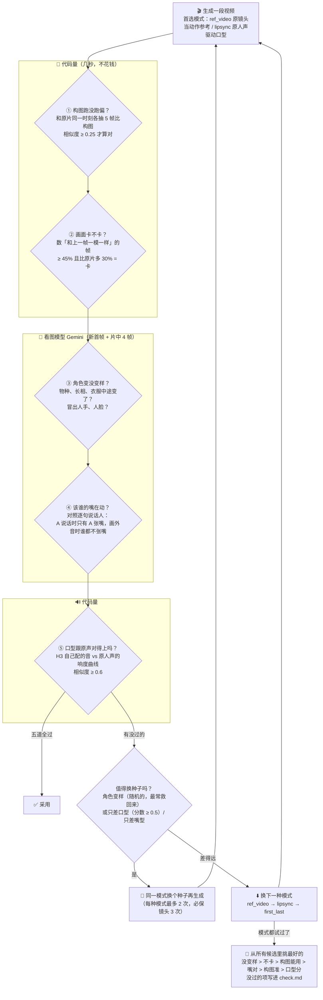

# rea-toon-remake — 在拆解好的短剧上换角色 / 换画风复刻

> [rea-toon](../README.md) 的下游应用。拿一条已经用 `rea-toon` 拆解并审定（`rea-toon lock`）的短剧，
> **剧情、分镜、运镜、情绪、节奏、原声全部保留**，只把你指定的元素换掉：角色（比如把新郎新娘换成孙悟空和白晶晶）、
> 服装、带货的产品、场景和道具，或者把整部片换个画风、换个 IP。

复刻只读锁定的 `story.json`，自己不分析原片：谁说哪句、每场穿什么、每镜看点和风险，全部来自审过的拆解。
拆解缺什么，回到 `rea-toon` 补，再重新 lock。

思路来自两个项目：

- [REA / rea-video](https://github.com/JuneYaooo/rea-video)：先把视频**逆向成可复查的"源码"**（rea-toon 做的事）。
- [hypit](https://github.com/hypit-ai/hypit)：源码里每个角色是一个**可替换的组件**，形成依赖图（角色设定图 → 镜头关键帧 → 视频片段 → 成片）；换一个组件，只重做依赖它的部分。

模型只用目前接得住短剧剧情和情绪的组合：**gpt-image-2**（设定图、逐镜换角色的关键帧）+ **MiniMax H3**（AutoDL）或 **Seedance 2.0**（视频）。

## 流程

```
 1 拆剧本    参考视频 ─► analyze：切镜、字幕 OCR、人声/配乐分轨、VLM 角色表 + 逐镜拆解
             ─► 全剧级核对：逐句标说话人、乔装/换装的同一人合并
             ─► 深度拆解：画风档案、分场造型、戏剧节拍和看点、风险标签、一致性检查 ─► breakdown.html
             ─► 人工审 ─► lock（复刻只读锁定的拆解，自己不再分析原片）
 2 定范围    和用户确认换谁（主角？配角？群众？）─► remake.yaml
 3 看计划    plan：重做哪些镜头、每镜视频模式、调用次数、哪些角色保持原样、试跑镜头（不花钱）
 4 关键帧    角色设定图 ─► 原首/尾帧逐张换人（gpt-image-2）─► 自动质检 ─► 人工审 review.jpg
 5 试跑      run --pilot：对白 / 群众宽镜头 / 边说边大运镜 各一镜 ─► 出视频、拼片、自查 ─► 有问题先改配置
 6 全片      每镜生成一段视频 ─► 过五道检查（见下图）─► 不合格换种子或换模式，留最好的一个
 7 拼成片    按磁盘上的片段拼回、按片段帧率出片（H3 24 fps）、画面按时差平移、逐段核对帧数 ─► 重烧字幕 ─► 铺原音轨
 8 自查      run 结束自动 check：时间线、漏换、五道检查没过的镜头、口型分数 + 中段抽帧、字幕抽帧 ─► 人工看完再交付
```

### 每段视频是怎么判断合格的

视频模型经常"看起来差不多，但细看不对"。所以每段视频生成后都不直接用，先过五道检查。
前两道和最后一道是**代码量出来的数**（几秒、不花钱），中间两道让**看图模型**（Gemini，只看图不看视频：
从片子里抽 4 帧，加上审过的新首帧一起给它）逐项回答。



每一道都对应一个真实踩过的坑（来自猫狗版《裙摆藏不住》）：

| 检查 | 抓的是什么 | 当时的样子 |
|---|---|---|
| ① 构图 | 音频驱动的模式会改景别、换背景、中途切镜头 | 中景对白变成大特写，背景换了一家餐厅 |
| ② 卡顿 | H3 首尾帧模式（FL2VA）画面几乎不动，每 4 帧跳一下 | 26 个镜头静止帧 70–96%，看着一顿一顿的；正常片段 ≤ 33% |
| ③ 变样 | 原镜头当参考时，原片的人会"长回来"；配角中途换品种 | 柴犬服务员长出人手；金毛服务员中途变成柴犬 |
| ④ 嘴型 | 一镜里两人对话、或画外音，模型让画面里的人"替"别人说 | 弟弟在画外说话，画面里的猫总裁却一直在张嘴 |
| ⑤ 口型 | H3 会自己给台词配音，嘴跟的是它自己的声音 | 嘴比原声晚半拍：分数 ≥ 0.5 时记下时差，拼接时平移画面 |

检查之前还有两步预防，从源头少出错：
- **逐句说话人**：拿整部剧的台词和上下文判断每一句是谁说的、嘴在不在画面里（不再一镜只认一个说话人）；
  lipsync 送进模型的人声里，画外的台词先静音——听得见谁的声音，模型就让画面里的嘴跟谁动。
- **同一人合并**：人名卡写着 A、画面里却只有 B，或两人从不同框，就让看图模型只比这一对的脸和剧情；
  是同一人（乔装、女扮男装）就合并，按镜头换衣服，不会变成两个不同的新形象。

保真靠这几件事：

1. **只重做受影响的镜头**：没有被换角色的镜头直接用原片，零成本、完全保真。
2. **首尾帧双约束**：每个重做的镜头都从原片的首帧和尾帧改出来（只换人，构图/机位/光线/表情不动）。
3. **原镜头当动作参考**（自部署 H3 Ref2VA）：把原镜头（人脸和字幕打码）交给 H3，运镜、走位、动作节奏一一对应，
   新关键帧和设定图定长相。打码是必须的：不打码 H3 会把原演员的脸带回来；打码后衣着体型仍可能被照抄，
   所以生成后要过上面的五道检查。0.8–2 秒的短镜头把参考视频补到 2 秒也走这条路（首尾帧模式画面几乎不动）。
4. **口型事后对齐**：H3 会自己给台词配音，嘴跟它自己的声音走。生成后比较它的音轨和原人声，对不上就换种子重试，
   对得上但有时差就在拼接时平移画面，让嘴落在原声上。
5. **表演拆解**：每个重做镜头先从原片抽 6 帧做逐秒表演拆解（眉眼、嘴、头手怎么动，以及禁止项），写进视频提示词。
6. **关键帧自动质检**：每张换人的关键帧都和原帧比一遍，不通过带着问题重画；原帧里小到看不清的人直接用原帧。
7. **字幕重烧**：OCR 出带时间的字幕轨；关键帧去字幕；给了音频的模式提示词不写台词原文（否则模型会把台词画成字幕），
   成片再兜底擦掉模型画的字幕，按原位置、原时间重烧。
8. **按输入 hash 缓存**：改一个角色，只重做它的设定图和它出现的镜头；失败镜头重跑同一命令续跑，不重复计费。
9. **先试跑再全片**：`--pilot` 用 3 个最容易出问题的镜头验证模型的实际行为，十几分钟发现问题，不用等全片跑完。
10. **交付前自查**：`run` 结束自动 `check`，查时间线、漏换镜头、五道检查没过的镜头、口型分数，出中段抽帧和字幕抽帧给人看。

## 安装

```bash
pip install -e . -e ./remake            # 在仓库根目录：先装拆解包 rea-toon，再装复刻包；需要 Python ≥ 3.10、ffmpeg
pip install -e ~/code/github/rea-video # 切镜和人声/配乐分轨用 rea-video
```

密钥从 `--env-file`、`./.env` 或 `~/code/github/capsule-cinema/.env` 读取（复用 capsule-cinema 的配置）：

| 用途 | 环境变量 |
|---|---|
| gpt-image-2（默认 cyber = Chybenzun 渠道） | `CHYBENZUN_GPT_IMAGE2_BASE_URL` / `_API_KEY`（或 `KRILL_*`、`JULING_*`） |
| MiniMax H3（AutoDL.Art） | `AUTODL_ART_TOKEN` |
| Seedance 2.0（火山方舟） | `ARK_API_KEY`，可选 `ARK_SEEDANCE_MODEL` |
| VLM 拆剧本 | `REA_TOON_VLM_BASE_URL` / `_API_KEY` / `_MODEL`，或 capsule-cinema 的 `GEMINI3_*` |
| 抖音分享链接解析 | `XIAOLVFANG_API_TOKEN` |
| VLM 备用模型（主模型都不可用时，在第一个 VLM 端点上试这些模型名） | `REA_TOON_VLM_FALLBACK_MODELS`，逗号分隔 |
| 图片兜底：中转渠道连续失败（重试 5 次、间隔递增）后改用本机 `codex` CLI 的画图工具；关掉设 `0` | `REA_TOON_CODEX_FALLBACK`（默认开，需要本机装好并登录 codex） |

## 快速开始：把《14亿人都来参加婚礼》换成孙悟空和白晶晶

```bash
# 1. 导入 + 拆剧本（只花 VLM 的钱）
rea-toon analyze work/wedding --source "https://v.douyin.com/QcaNeGuOM-A/"
open work/wedding/breakdown.html     # 审深度拆解：分场造型、看点、风险、要处理的问题
rea-toon lock work/wedding           # 审完锁定，之后才能复刻

# 2. 写换角色配置（或 rea-toon-remake init work/wedding my_remake 生成模板）
cat remake/examples/wukong_wedding/remake.yaml

# 3. 看计划：重做哪些镜头、多少次调用
rea-toon-remake plan work/wedding remake/examples/wukong_wedding/remake.yaml

# 4. 先出设定图和关键帧审一遍
rea-toon-remake run work/wedding remake/examples/wukong_wedding/remake.yaml --until frames
open work/wedding/remakes/wukong_wedding/review.jpg

# 5. 试跑 3 个代表镜头，看自查结果
rea-toon-remake run work/wedding remake/examples/wukong_wedding/remake.yaml --pilot

# 6. 出全片 + 拼成片 + 自动自查（看 check.md、check_frames.jpg、check_subs.jpg）
rea-toon-remake run work/wedding remake/examples/wukong_wedding/remake.yaml
open work/wedding/remakes/wukong_wedding/compare.mp4
```

全员换成西游记（各路神仙妖怪来参加孙悟空和白骨精的婚礼）：见 [examples/xiyou_wedding/remake.yaml](examples/xiyou_wedding/remake.yaml)。
12 个角色逐个对应（收礼大爷→太白金星、停车指挥员→猪八戒、服务员→哪吒、司仪→唐僧、吃席大妈→王母娘娘……），群众写成 `crowd`，会画群像设定图，宽镜头里成片的人一起换。

`remake.yaml`：

```yaml
name: wukong_wedding
style:                 # 留空 = 保持原画风；写 "3D 皮克斯动画电影风格" 就整片换画风（所有镜头重做）
video_engine: h3local  # h3local（自部署 H3）| h3（托管 API）| seedance
frames: first_last
cast:
  groom:               # story.json 里的角色 id
    name: 孙悟空
    look: 写实电影质感的齐天大圣：猴脸、金棕色猴毛、火眼金睛、金箍、凤翅紫金冠翎羽……
    costume: keep      # 穿原角色的衣服（黑西装 + "新郎"胸花）；也可以写新服装
    image: ./wukong.png  # 可选：你自己的角色参考图
    fx_color: 金色       # 可选：这个角色身上的特效（剑气、灵光）换成这个颜色；不写就和原片一样
  bride:
    name: 白晶晶
    look: 银白长发盘成新娘发髻、肤白如瓷、眉心花钿……原创形象
```

换产品、换场景、一镜里多个状态（换装）时还会用到：

```yaml
style: >-              # 换场景：写"原来的 A 换成 B"的对应关系
  厨房台面换成露营木桌，背景换成帐篷和树林；香蕉换成草莓
aigc_label: AI生成     # 成片的 AI 生成内容标识（《人工智能生成合成内容标识办法》要求显式标识）；原片有标识就放在原位置，写 "" 不加
kenburns: true         # 原片是一张图在推拉（动态漫画）的镜头：用新关键帧在本地推拉，不调视频模型
expression_sheet: false  # 给被换的角色多画一张表情设定图，关键帧照着画表情（防变脸，多一次出图）
anchors:               # 长镜头中间额外锁几张关键帧（镜头号: [镜头内秒数]）
  2: [1.0]
frame_notes:           # 给单张关键帧的要求（first / last / a1 …）
  2: {a1: "穿第二套：焦糖色麂皮西装 + 米白针织内搭"}
cast:
  juicer:              # 换产品：产品不在角色表里，写 kind: object
    kind: object
    original: 灰紫色便携榨汁杯，透明杯身，底座数显屏
    name: 樱花粉便携榨汁杯
    look: 原创工业设计，无品牌字样……
```

常用参数：

| 命令 | 作用 |
|---|---|
| `rea-toon analyze WORK [--source 视频] [--cuts 6.65,9.92]` | 导入并拆剧本 → `story.json` / `story.md`；`--cuts` 在溶解、穿门、遮挡转场处强制切镜（单镜需 ≤15s） |
| `rea-toon breakdown WORK` | 深度拆解（analyze 会自动做）：画风档案、分场造型、戏剧节拍和逐镜看点、风险、一致性检查 → `breakdown.html` |
| `rea-toon lock WORK [--force]` | 审完拆解后锁定；`rea-toon-remake run` 只在锁定的拆解上运行，之后改 story.json 要重新 lock |
| `rea-toon-remake init WORK NAME` | 按角色表生成 `remake.yaml` 模板 |
| `rea-toon-remake plan WORK SPEC` | 列出重做镜头、帧编辑方式、视频模式和调用次数 |
| `rea-toon-remake run WORK SPEC [--until cast\|frames] [--shots 1,28-30]` | 生成；可先停在设定图或关键帧；`--shots` 只处理这几镜，成片仍是整部片 |
| `rea-toon-remake run WORK SPEC --pilot` | 试跑 plan 选出的 3 个代表镜头，出视频、拼片、自查 |
| `run ... --redo 28 --force frames,clips` | 强制重做指定镜头的指定阶段 |
| `rea-toon-remake assemble WORK SPEC` | 只重新拼成片 |
| `rea-toon-remake check WORK SPEC` | 交付前自查：时间线、漏换镜头、口型同步分数、中段抽帧、字幕抽帧 → `check.md` |

## 产物

```
work/wedding/
  source.mp4  source.json
  decomp/               rea-video 拆解（切镜、分轨 stems/vocals.wav music.wav、报告）
  subtitles.json/.srt   带时间的字幕轨
  frames/               每镜原始首/中/尾帧
  story.json  story.md  剧本源码（可手改：角色归属、逐镜提示词）
  breakdown.html/.md    深度拆解审核页（分场造型、看点、风险、要处理的问题）
  remakes/wukong_wedding/
    plan.json  results.json
    cast/       角色设定图
    frames/     每镜新首帧/尾帧（*.meta.json 记录提示词和输入 hash）
    clips/      每镜生成的视频
    final.mp4   compare.mp4（左原片 右复刻）  review.jpg（原首帧|新首帧|原尾帧|新尾帧）
```

## 局限

- 声音目前只支持保留原声；换角色的同时换音色（TTS/克隆）还没做。
- 口型是事后对齐（整段平移 + 换种子），不是逐字驱动；大运镜的对白镜头只能走首尾帧，口型常对不上。
- 参考原镜头生成时，原片的人偶尔会在片中途"长回来"（尤其群众和远处小人），要靠 `check_frames.jpg` 人工发现，
  列进 `no_motion_ref` 重做。
- 角色识别靠 VLM：远景小人、背影偶尔漏标，要在 `story.md` 里核一遍，必要时手改 `story.json`。
- 极短镜头（< 2s）只能生成更长再截取，快切镜头的动作会比原片少。

## 效果展示

### 《14亿人都来参加婚礼》→ 西游记

参考片：抖音《14亿人都来参加婚礼会怎样？》（115.5s，36 镜，对白 + 歌曲）。

| 版本 | 换了什么 | 配置 |
|---|---|---|
| 换主角 | 新郎 → 孙悟空，新娘 → 白晶晶，其余不变（9 镜重做、27 镜复用原片） | [wukong_wedding](examples/wukong_wedding/remake.yaml) |
| 全员西游记 | 12 个角色 + 群众全部换成西游记人物：司仪 → 唐僧、收礼大爷 → 太白金星、服务员 → 哪吒、吃席群众 → 各路神仙妖怪…… | [xiyou_wedding_h3local](examples/xiyou_wedding_h3local/remake.yaml) |

台词、歌曲、音效用原声，字幕按原时间重烧，对白镜头口型对齐原声。
